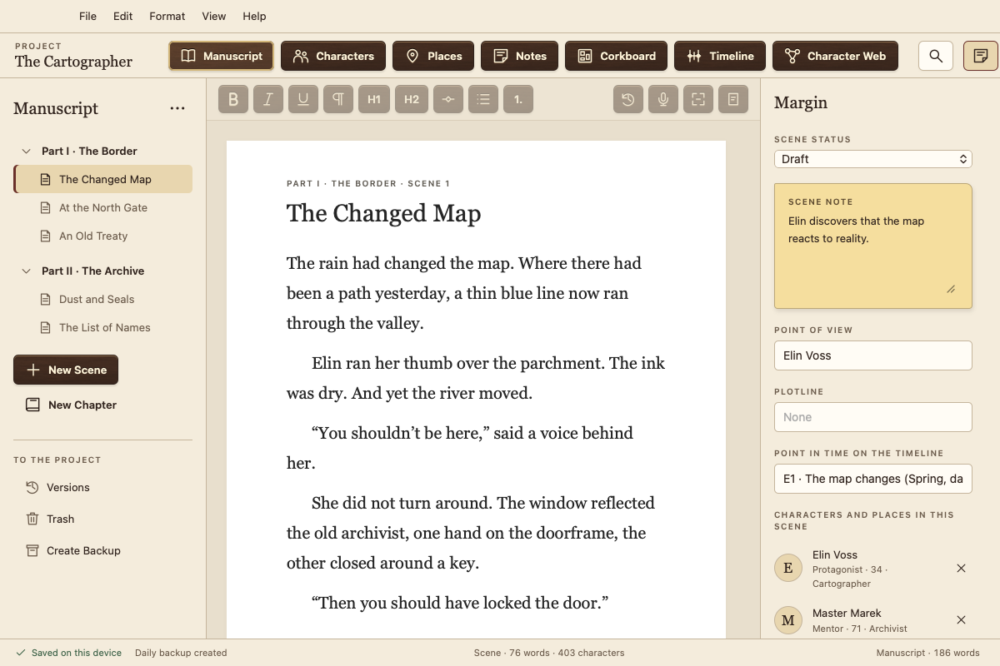
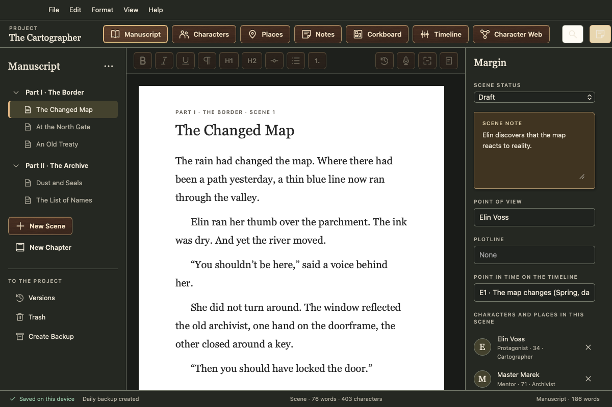
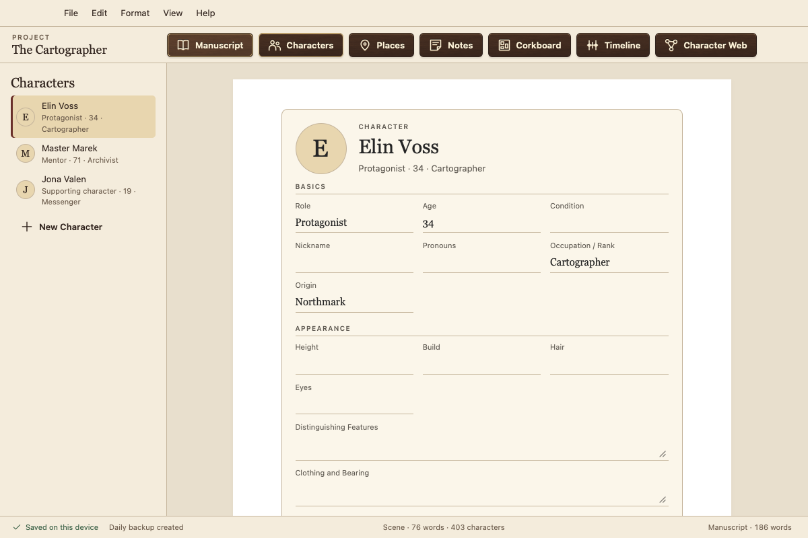
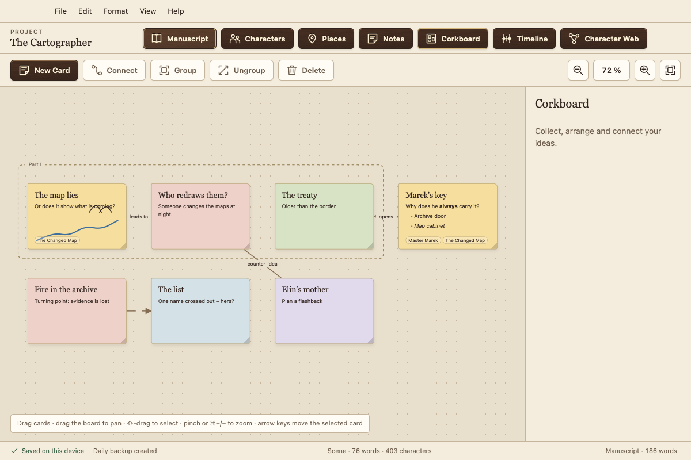
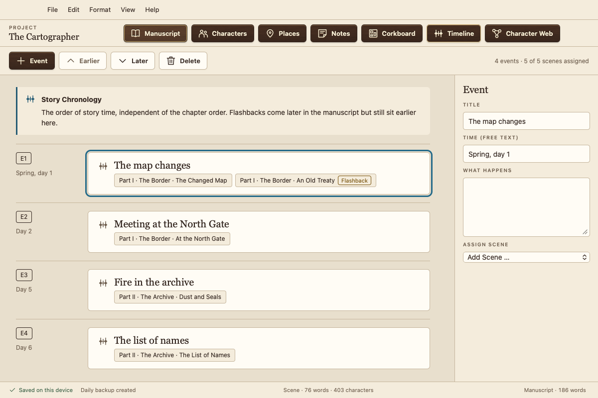
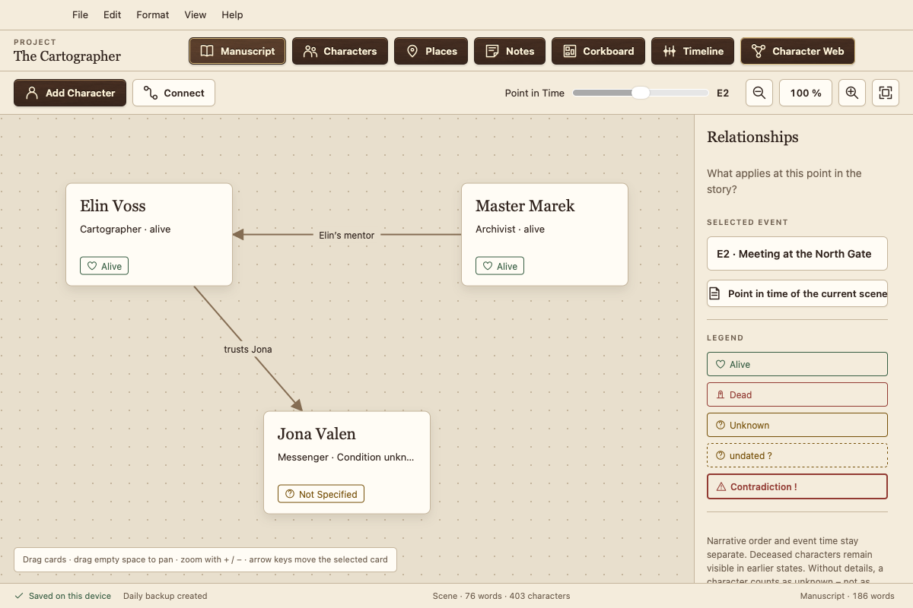

# Atramentum

**A free writing app for novelists. Your manuscript stays on your device. No subscription, no account, no data collection, no AI training.**

[Deutsch](README.md) · **English** · [Website](https://sammielpadre.github.io/Atramentum/en/)

Atramentum is built for long fiction: your book is organised in chapters and scenes, and alongside it you keep characters, places, notes, a corkboard, a timeline and a character web, all in one project.

- **Free.** No paid tier, no subscription, no account, no ads.
- **Private.** Everything is stored locally and works offline. Atramentum never sends your texts or personal data anywhere. If you allow it, it checks once a day for a new version, and that's all.
- **Safe.** Every change is saved immediately. You also get versions of each scene, a trash folder, automatic daily backups and a separate rescue tool.
- **Planning built in.** A corkboard with notes, groups and connections, a timeline that tracks story time and spots flashbacks, and a **character web** that shows relationships and who is alive at any point in your story.
- **Import and export.** Import from Word, Markdown and plain text. Export to Word, PDF (standard manuscript format or reading copy), Markdown and plain text.
- **On all your devices.** Mac, Windows, Linux and Android, with iPhone and iPad coming via the App Store. Sync through a folder in the cloud service you already use (iCloud Drive, Dropbox, OneDrive …), with no account on our side.
- **Light or dark, in six languages:** English, German, French, Spanish, Portuguese and Italian.
- **One-click updates** from inside the app.

## Screenshots

<table>
<tr>
<td width="50%"> Dark mode for late-night writing</td>
<td width="50%"> Character sheet with your own fields</td>
</tr>
<tr>
<td> Corkboard: notes, groups and connections</td>
<td> Timeline: story time, flashbacks detected</td>
</tr>
<tr>
<td colspan="2"> Character web: relationships and character states at any point in the story</td>
</tr>
</table>

Sample project “The Cartographer”, Mac version. Atramentum looks the same on Windows and Linux, with that system's window frame.

> **Early testing phase:** current versions are test releases. Please make regular backups (File › Create Backup …) and tell me what you notice.

## Download

<!-- DOWNLOAD -->
**Version 0.1.3** (2026-11-12)

| System | Download | Guide |
|---|---|---|
| **Mac** (macOS 13+, Apple silicon and Intel) | [Atramentum-0.1.3.dmg](https://github.com/SammiElPadre/Atramentum/releases/download/v0.1.3/Atramentum-0.1.3.dmg) (16 MB) | [Installing on Mac](docs/Installation-Mac.en.txt) |
| **Windows** 10 and 11 (64-bit) | [Atramentum_0.1.3_x64-setup.exe](https://github.com/SammiElPadre/Atramentum/releases/download/v0.1.3/Atramentum_0.1.3_x64-setup.exe) (4 MB) | [Installing on Windows](docs/Installation-Windows.en.txt) |
| **Linux** Ubuntu, Debian, Mint | [Atramentum_0.1.3_amd64.deb](https://github.com/SammiElPadre/Atramentum/releases/download/v0.1.3/Atramentum_0.1.3_amd64.deb) (6 MB) | [Installing on Linux](docs/Installation-Linux.en.txt) |
| **Linux** all others | [Atramentum_0.1.3_amd64.AppImage](https://github.com/SammiElPadre/Atramentum/releases/download/v0.1.3/Atramentum_0.1.3_amd64.AppImage) (84 MB) | [Installing on Linux](docs/Installation-Linux.en.txt) |
| **Android** 7 and later (phone and tablet) | [Atramentum_0.1.3_android.apk](https://github.com/SammiElPadre/Atramentum/releases/download/v0.1.3/Atramentum_0.1.3_android.apk) (47 MB) | [Installing on Android](docs/Installation-Android.en.txt) |

Checksums and rescue tools: [release page](https://github.com/SammiElPadre/Atramentum/releases/tag/v0.1.3).
<!-- /DOWNLOAD -->

## First launch

Atramentum is not notarized by Apple and not signed with a Microsoft certificate, because certificates cost money every year and Atramentum is free. That's why your system asks once before the first start:

- **Mac:** Drag Atramentum into Applications and double-click it. When macOS says it cannot verify the app, click **Done**. Then open **System Settings › Privacy & Security**, scroll down to the note about Atramentum and click **Open Anyway**. You only need to do this once.
- **Windows:** If you see “Windows protected your PC”, click **More info**, then **Run anyway**. No administrator rights are needed.
- **Linux:** `sudo apt install ./Atramentum_<version>_amd64.deb`, or make the AppImage executable (`chmod +x`) and start it. On newer Ubuntu versions the AppImage needs `libfuse2t64`.
- **Android:** Open this page on the device and tap the `.apk` file. Allow your browser to install apps when asked. If Play Protect warns that the app is unknown, that is because it is not from the Play Store: choose **More details › Install anyway**.

After that, Atramentum keeps itself up to date via **Help › Check for Updates …**. Step-by-step guides: [Mac](docs/Installation-Mac.en.txt) · [Windows](docs/Installation-Windows.en.txt) · [Linux](docs/Installation-Linux.en.txt) · [Android](docs/Installation-Android.en.txt).

## Bugs and wishes

Bug reports and feature requests are welcome: [new issue](../../issues/new/choose). English is fine. I read every report and build in what fits Atramentum.

Please note that issues are public, so don't paste manuscript text into them.

Atramentum's source code is not public, and I don't accept code contributions or pull requests at the moment.

## Support

Atramentum stays free. If you'd like to support its development voluntarily, you can do so on [Ko-fi](https://ko-fi.com/sammielpadre). Donations don't unlock anything and are never required.

## Legal

Atramentum is free software in the freeware sense; see the [terms of use](LIZENZ.txt) (German). You may pass on the unmodified download file, but you may not sell it. Licenses of the third-party components it contains (Tauri, SQLite and others) are listed in the app under Help › Third-Party Licenses.
