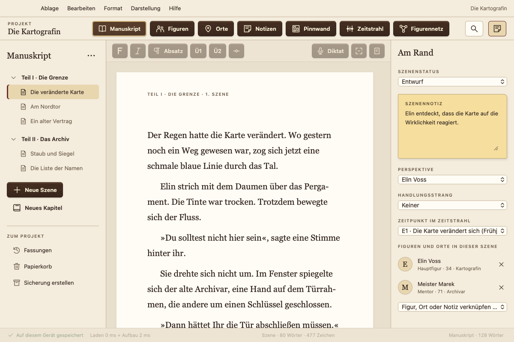
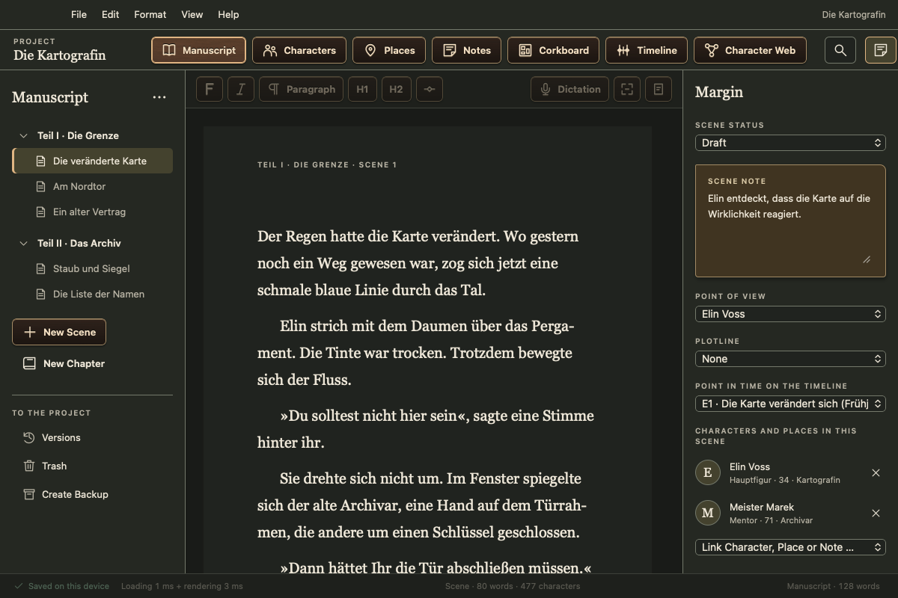
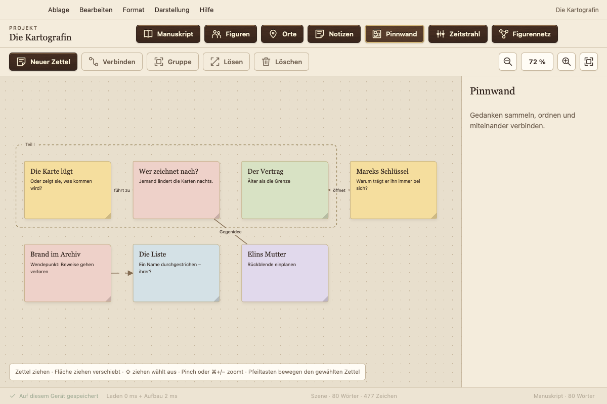
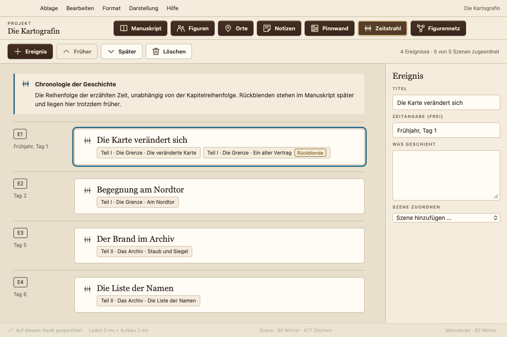
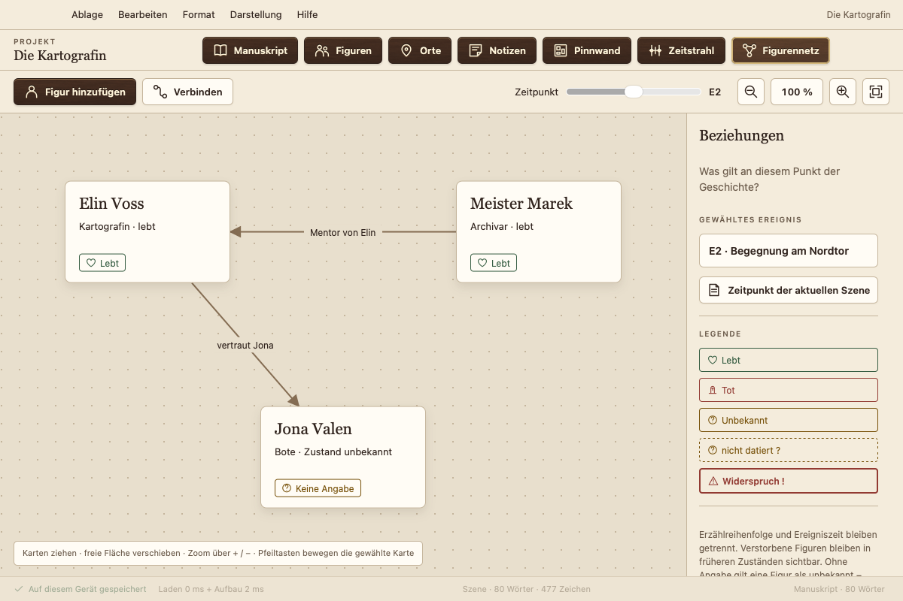
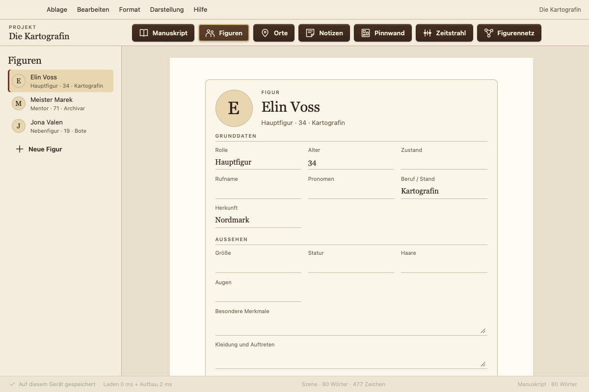

# Atramentum

**Das kostenlose Schreibprogramm für Romane. Ihr Manuskript bleibt bei Ihnen: kein Abo, kein Konto, keine Datensammlung, kein KI-Training.**

**Deutsch** · [English](README.en.md) · [Webseite](https://sammielpadre.github.io/Atramentum/)

Atramentum ist für lange Texte gebaut. Ihr Buch besteht aus Kapiteln und Szenen. Dazu kommen Figuren, Orte, Notizen, eine Pinnwand, ein Zeitstrahl und ein Figurennetz, alles in einem Projekt.

- **Kostenlos**, ohne Bezahlversion, Abo, Konto oder Werbung.
- **Ihre Texte bleiben bei Ihnen:** Atramentum speichert lokal auf Ihrem Rechner und braucht kein Internet. Es sendet keine Texte oder persönlichen Daten. Nur wenn Sie es erlauben, fragt es einmal am Tag nach einer neuen Version.
- **Sicher:** Gespeichert wird bei jeder Änderung. Dazu kommen Fassungen jeder Szene, ein Papierkorb, tägliche automatische Sicherungen und ein Rettungswerkzeug.
- **Planung eingebaut:** eine Pinnwand mit Zetteln, Gruppen und Verbindungen, ein Zeitstrahl, der die erzählte Zeit verfolgt und Rückblenden erkennt, und ein **Figurennetz**, das Beziehungen und Zustände zu jedem Zeitpunkt der Geschichte zeigt.
- **Austausch:** Import aus Word, Markdown und Text, Export als Word, PDF (Normseite oder Leseexemplar), Markdown und Text.
- **Hell oder dunkel, in sechs Sprachen:** Deutsch, Englisch, Französisch, Spanisch, Portugiesisch, Italienisch.
- **Updates per Klick** direkt in der App.
- **Auf allen Geräten:** Mac, Windows, Linux und Android; iPhone und iPad folgen über den App Store. Abgleich zwischen Geräten über einen Ordner Ihres Cloud-Dienstes (iCloud Drive, Dropbox, OneDrive …), ohne Konto bei uns.

## So sieht Atramentum aus

<table>
<tr>
<td width="50%"> Dunkler Modus für den Abend</td>
<td width="50%"> Oberfläche auf Englisch (auch Französisch, Spanisch, Portugiesisch, Italienisch)</td>
</tr>
<tr>
<td> Pinnwand: Zettel, Gruppen und Verbindungen</td>
<td> Zeitstrahl: erzählte Zeit, Rückblenden erkannt</td>
</tr>
<tr>
<td> Figurennetz: Beziehungen und Zustände zu jedem Zeitpunkt der Geschichte</td>
<td> Figurenbogen wie ein Charakterbogen</td>
</tr>
</table>

Beispielprojekt „Die Kartografin“, Mac-Fassung. Unter Windows und Linux sieht Atramentum gleich aus, mit der Fensterleiste des jeweiligen Systems.

> **Testphase:** Die aktuellen Versionen sind Testfassungen. Bitte legen Sie regelmäßig Sicherungen an (Ablage bzw. Datei › Sicherung erstellen …) und melden Sie, was Ihnen auffällt.

## Herunterladen

<!-- DOWNLOAD -->
**Version 0.1.7** (2026-11-14)

| System | Download | Anleitung |
|---|---|---|
| **Mac** (macOS 13+, Apple-Chip und Intel) | [Atramentum-0.1.7.dmg](https://github.com/SammiElPadre/Atramentum/releases/download/v0.1.7/Atramentum-0.1.7.dmg) (17 MB) | [Installation Mac](docs/Installation-Mac.txt) |
| **Windows** 10 und 11 (64 Bit) | [Atramentum_0.1.7_x64-setup.exe](https://github.com/SammiElPadre/Atramentum/releases/download/v0.1.7/Atramentum_0.1.7_x64-setup.exe) (4 MB) | [Installation Windows](docs/Installation-Windows.txt) |
| **Linux** Ubuntu, Debian, Mint | [Atramentum_0.1.7_amd64.deb](https://github.com/SammiElPadre/Atramentum/releases/download/v0.1.7/Atramentum_0.1.7_amd64.deb) (6 MB) | [Installation Linux](docs/Installation-Linux.txt) |
| **Linux** alle anderen | [Atramentum_0.1.7_amd64.AppImage](https://github.com/SammiElPadre/Atramentum/releases/download/v0.1.7/Atramentum_0.1.7_amd64.AppImage) (84 MB) | [Installation Linux](docs/Installation-Linux.txt) |
| **Android** 7 und neuer (Telefon und Tablet) | [Atramentum_0.1.7_android.apk](https://github.com/SammiElPadre/Atramentum/releases/download/v0.1.7/Atramentum_0.1.7_android.apk) (70 MB) | [Installation Android](docs/Installation-Android.txt) |

Prüfsummen und Rettungswerkzeuge: [Release-Seite](https://github.com/SammiElPadre/Atramentum/releases/tag/v0.1.7).
<!-- /DOWNLOAD -->

Atramentum ist nicht bei Apple notarisiert und nicht mit einem Microsoft-Zertifikat signiert. Deshalb fragen macOS und Windows beim ersten Start einmal nach, Android beim Installieren; die Anleitungen zeigen, wie Sie trotzdem öffnen. Danach hält sich Atramentum über **Hilfe › Nach Updates suchen …** selbst aktuell.

## Anleitungen

- Installation: [Mac](docs/Installation-Mac.txt) · [Windows](docs/Installation-Windows.txt) · [Linux](docs/Installation-Linux.txt)
- [Einführung](docs/EINFUEHRUNG.md)
- [Rettungsanleitung](docs/RETTUNG.md)
- [Bekannte Grenzen](docs/GRENZEN.md)

## Fehler und Wünsche

Fehlerberichte und Wünsche sind willkommen: [Neue Meldung](../../issues/new/choose). Ich lese jede Meldung und baue ein, was zu Atramentum passt.

Bitte beachten Sie: Meldungen sind öffentlich sichtbar. Kopieren Sie keine Manuskripttexte hinein.

Der Programmcode von Atramentum ist nicht öffentlich. Code-Beiträge und Pull Requests nehme ich derzeit nicht an.

## Unterstützen

Atramentum bleibt kostenlos. Wenn Sie die Entwicklung freiwillig unterstützen möchten: [Ko-fi](https://ko-fi.com/sammielpadre). Spenden schalten nichts frei und sind keine Voraussetzung für irgendetwas.

## Rechtliches

Atramentum ist kostenlose Software (Freeware), siehe [Nutzungsbedingungen](LIZENZ.txt). Sie dürfen die unveränderte Download-Datei weitergeben, aber nicht verkaufen. Die Lizenzen der enthaltenen Fremdkomponenten (Tauri, SQLite u. a.) stehen in der App unter Hilfe › Lizenzen Dritter.
